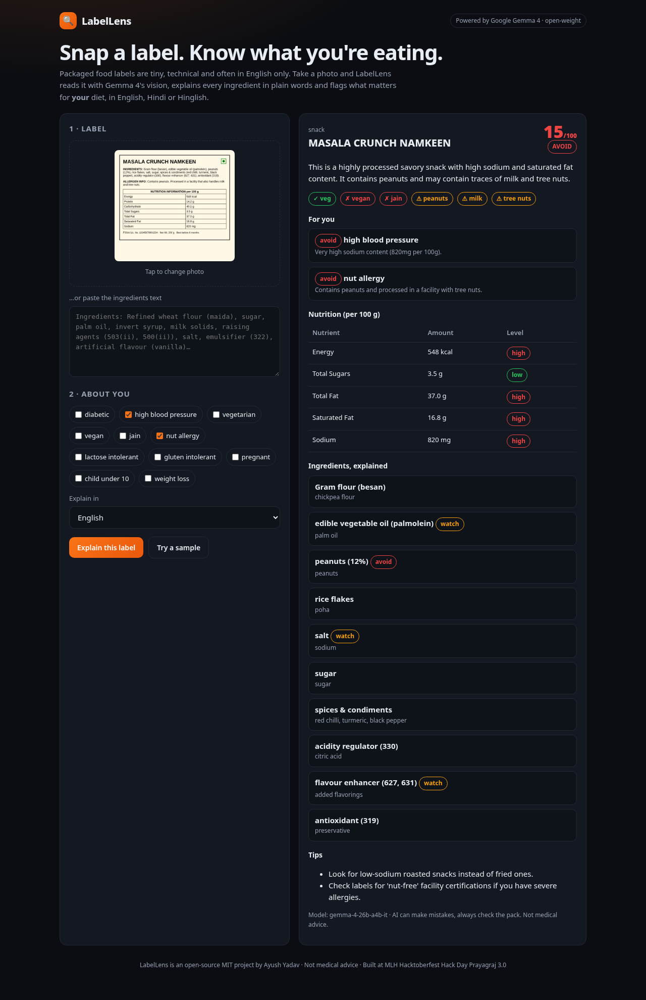

# 🔍 LabelLens

**Snap a food label. Know what you're eating.** LabelLens reads a photo of any packaged-food (or cosmetic) label with **Google Gemma 4's vision** and explains it in plain English, Hindi or Hinglish: what each ingredient is, allergens, veg/vegan/Jain fit, nutrition levels, and a clear verdict for *your* diet.



## Why
Indian food labels are small, technical and mostly English: "INS 627", "palmolein", "invert syrup". People with diabetes, high BP or allergies, and parents buying for kids, can't decode them in the shop aisle. LabelLens turns a 10-second photo into an answer anyone can read.

## Features
- 📷 **Photo or text input**: camera capture on mobile, drag & drop on desktop, or paste the ingredient list. Photos are resized on the device before upload.
- 🧠 **Gemma 4 multimodal**: reads the ingredient list, nutrition table, allergen line and the veg mark straight from the image.
- 🙋 **Personal profile**: diabetic, high BP, vegetarian, vegan, Jain, nut / lactose / gluten intolerance, pregnancy, kids, weight loss. You get ok / caution / avoid for each, with a reason.
- 🌐 **English, Hindi, Hinglish** explanations.
- 🔒 **Private**: no database and no login. The photo goes only to the Gemma API for that single answer.

## Prize track
**Best Use of Gemma 4** (Google DeepMind × MLH). It's a focused multimodal assistant for the community, built on an open-weight model through the Gemini API.

## Tech
- Vanilla HTML/CSS/JS frontend, with no build step and no dependencies.
- One Vercel serverless function, `api/scan.js`.
- **Google Gemma 4** (`gemma-4-31b-it` and `gemma-4-26b-a4b-it`, run in parallel with retries; the first valid answer wins) via the Gemini API `generateContent` with `inline_data` images.

## How it works
1. The browser shrinks the photo to 1280 px or less as JPEG, then POSTs `{ image, text, profile, lang }` to `/api/scan`.
2. `api/scan.js` builds one prompt and sends the image and text to Gemma 4. The model is asked for strict JSON.
3. The UI renders the score, verdict, diet badges, allergens, the per-profile advice, the nutrition table and the explained ingredients.

## Run locally
```bash
git clone https://github.com/ayush8620/labellens && cd labellens
cp .env.example .env          # add your free key from https://aistudio.google.com/apikey
export GEMINI_API_KEY=your_key
node server.js                # http://localhost:3000  (Node 18+, no npm install needed)
```
Test the API directly with the sample label in `docs/sample-label.png`:
```bash
IMG="data:image/png;base64,$(base64 -w0 docs/sample-label.png)"
curl -s localhost:3000/api/scan -H 'content-type: application/json' \
  -d "{\"image\":\"$IMG\",\"profile\":[\"nut allergy\"],\"lang\":\"Hindi\"}"
```

## Deploy (free)
Import the repo on [Vercel](https://vercel.com/new) (framework preset "Other"), add the environment variable `GEMINI_API_KEY`, and deploy.

## Files
| Path | What |
|---|---|
| `index.html`, `style.css`, `app.js` | UI |
| `api/scan.js` | label analysis endpoint |
| `api/_gemma.js` | Gemma 4 client (parallel models, retries, JSON parsing) |
| `server.js` | zero-dependency local dev server that mimics Vercel |
| `docs/` | screenshot and sample label |

## Disclaimer
LabelLens is AI-generated guidance, **not medical advice**. Always read the pack and ask a doctor for medical decisions.

## License
[MIT](LICENSE) © 2026 Ayush Yadav. Built at MLH Hacktoberfest Hack Day Prayagraj × WikiClub Tech UIT (Edition 3.0).
